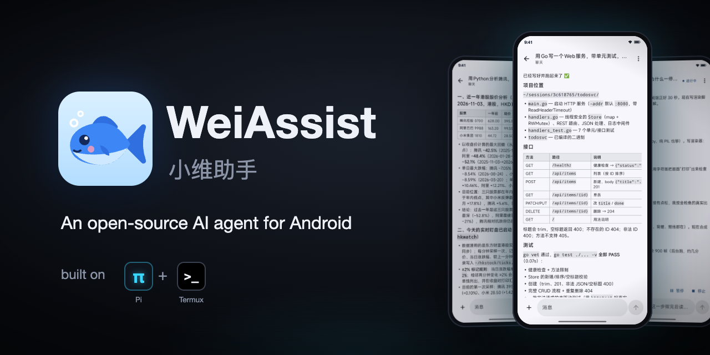
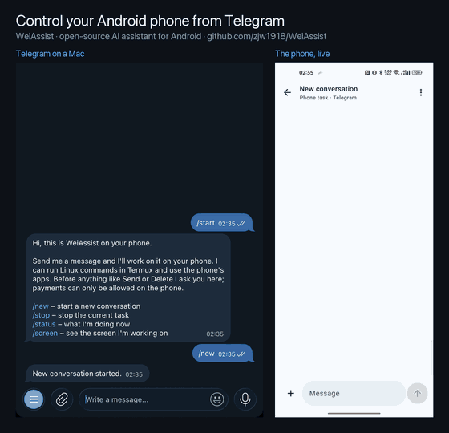
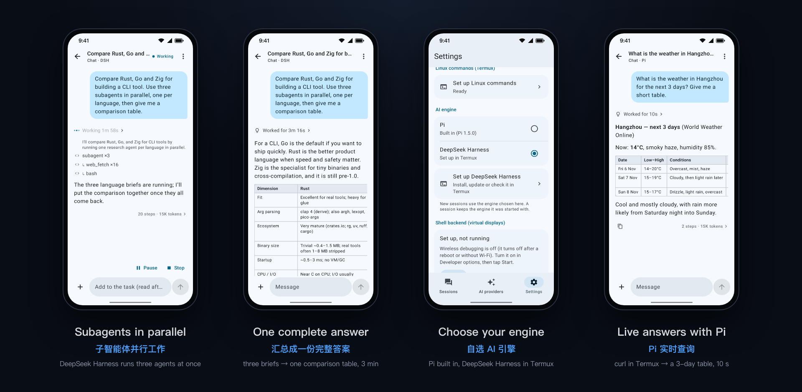
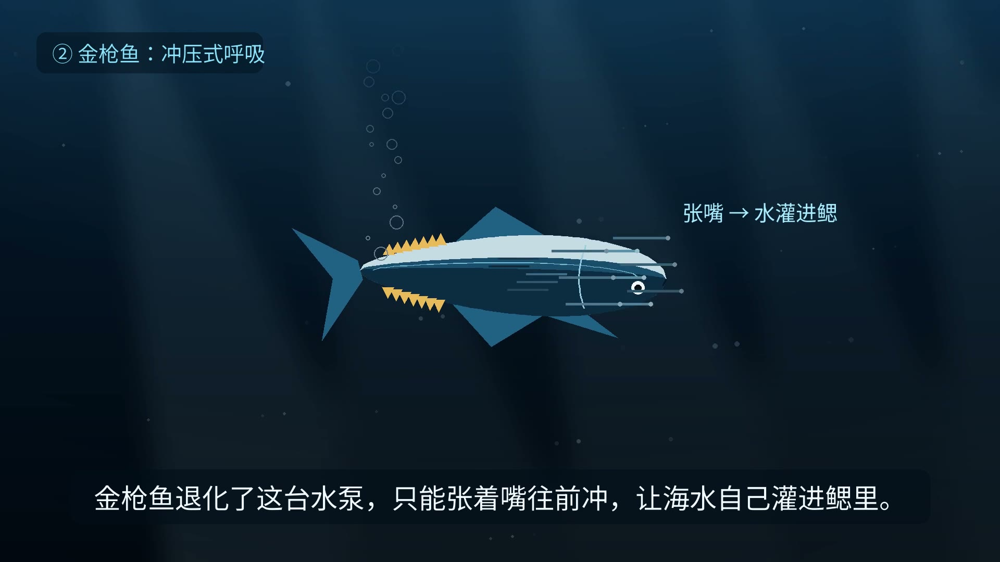

# WeiAssist · 小维助手

**An open-source AI assistant for Android. Choose its AI engine: [Pi](https://github.com/earendil-works/pi)
or [DeepSeek Harness](https://github.com/deepseek-ai/deepseek-harness).**
Chat with the AI provider of your choice, hand it files and photos, let it run Linux commands for live
information and coding, and keep several conversations going at once. **Away from your phone? Talk to it
from Telegram.** No servers of ours in between: the app talks to your provider (and your Telegram bot) directly.

The engine, or agent harness, runs the agent loop: it calls the model, uses tools and keeps the conversation.
WeiAssist brings it to the phone with a native app around it. Pi, the minimal, extensible harness, is built in.
DeepSeek Harness can be added from the app.

> **Status: early development.** It works on real devices (Android 12 to 16), but expect rough edges.
> What's done and what's next: [PROGRESS.md](docs/PROGRESS.md) and the [roadmap](docs/ROADMAP.md).

## Features

### 🧠 Choose your AI engine: Pi or DeepSeek Harness

WeiAssist isn't tied to one agent harness. Pick the engine for new conversations in **Settings → AI engine**:

- **Pi** (built in): fast to start, and works right away with any provider.
- **DeepSeek Harness** (dsh), DeepSeek's open-source agent harness, with everything it can do: its own
  file, bash and job tools, subagents, web fetch, skills and workflows. The app's phone tools come on top.
  It runs in a small Ubuntu inside [Termux](https://termux.dev), and **Settings → AI engine → Set up DeepSeek
  Harness** installs it for you, showing each step as it goes. It works in mainland China too, with mirrors for
  every download. By default it installs the dsh version this app was tested with; you can also install a newer
  one or any version you choose, and go back.

Both engines use the same providers, keys and sign-ins: set them up once. Both also get the same safety checks:
before anything like Send, Pay or Delete, either engine has to ask you, and Stop works the same way. Your API
keys stay in the app: DeepSeek Harness reaches your provider through the app and never holds a key. Each
conversation keeps the engine it started with, and the list shows which one that is.

### 💬 Talk to it from Telegram

Message the assistant on your phone from anywhere: from Telegram on another phone, a tablet or your computer.
Create a bot with @BotFather, paste its token in **Settings → Telegram**, pair your account with one tap, and
your phone's assistant is a chat away. Setup and details: [docs/TELEGRAM.md](docs/TELEGRAM.md).

<p align="center">
  
  <br>
  <sub>Asked from Telegram on a Mac: the weather (via Termux), then "email this forecast with Gmail". Before tapping
  Send it asks, in the chat and on the phone; Deny, and nothing is sent.</sub>
</p>

- **No server needed:** the app fetches your bot's messages from Telegram itself. Only accounts you pair can use it.
- **Each chat is a conversation**, also in the app's list. Answers stream in; `/new`, `/stop`, `/status`, and
  `/screen` to see the screen it is working on.
- **Photos and files both ways:** send it pictures, PDFs, spreadsheets or archives; it sends back the charts,
  documents and videos it makes in Termux.
- **You stay in control:** choose what it may do from Telegram: only talk, also run Linux commands, or also use
  the phone's apps. Before anything like Send or Delete it asks you in the chat (✅ / ❌) and on the phone;
  payments can only be allowed on the phone.

### Everything else



- **Many AI providers:** OpenAI (sign in with your ChatGPT subscription, or an API key), Anthropic, Google,
  DeepSeek, OpenRouter, xAI (sign in with SuperGrok or X Premium, or an API key), Moonshot, Mistral and
  OpenCode, for either engine.
- **Your own models:** add any OpenAI-compatible server, such as Ollama, vLLM, LM Studio or a relay. It fetches
  the model list and detects each model's context size, which you can correct.
- **Model and thinking level:** pick per provider, from what your sign-in can use.
- **Attachments:** send photos, PDFs and text or code files with a message. Images open in a full-screen viewer.
- **Linux commands (optional):** with [Termux](https://termux.dev) installed, the assistant can look things up on
  the web, work with data, and write, build and run code, with long jobs kept running in `tmux`.
  Setup: [docs/TERMUX.md](docs/TERMUX.md).
- **Several conversations at once:** each runs on its own and keeps going in the background, with saved
  history. Send a message while one is working and it reads it before its next step. A supervisor
  conversation can start, check and stop the others for you, by typing or by voice.
- **Phone tasks (optional):** if you turn on its accessibility service, it can also use apps on the phone for
  a task, and asks you before anything like Send, Pay or Delete.
- **Private by design:** sign-ins are stored only on the phone, encrypted with the Android Keystore. Password
  fields are never sent to a model.
- **English and Chinese UI.**

<p align="center">
  
  <br>
  <sub>A frame from the video in the last example: from one idea, the assistant wrote the script, generated the
  voice-over, drew and rendered the animation in Termux, all on the phone.</sub>
</p>

## Install

Download the APK from [Releases](https://github.com/zjw1918/WeiAssist/releases/latest) and install it (allow installs
from your browser or file manager when Android asks). You can also build from source (below).
Then open WeiAssist and connect it to an AI provider. Optional extras, all under **Settings**:
Linux commands (a guided Termux setup; details in [docs/TERMUX.md](docs/TERMUX.md)), the DeepSeek Harness engine
(needs Termux, about 1.5 GB of space and 10–30 minutes to install), phone tasks (accessibility), and Telegram
([docs/TELEGRAM.md](docs/TELEGRAM.md)).

## Build

Requirements: Android SDK (platform 37), Node per [`.nvmrc`](.nvmrc) with npm, and a JDK (Gradle provisions its own).

```bash
./gradlew assembleDebug     # also bundles Pi (pi-host/) and the DeepSeek Harness bridge (dsh-host/) into the app
cd pi-host && npm test      # end-to-end tests of the bundled agent
cd dsh-host && DSH_RUN=… DSH_HOME=… npm test   # the dsh bridge against a real dsh install (skipped without them)
./gradlew testDebugUnitTest lint
```

Maintainers publish a release by pushing a version tag (`git tag v0.2 && git push origin v0.2`): the Release workflow
builds, signs and attaches the APK. Locally, `assembleRelease` signs the APK only when it finds a key: a `keystore.properties` file (`storeFile`, `storePassword`,
`keyAlias`, `keyPassword`) at the path in `WEIASSIST_SIGNING`, or in `~/.android/weiassist-release/`. Without one the
release APK is unsigned.

How it fits together: [docs/ARCHITECTURE.md](docs/ARCHITECTURE.md). Contributing: [CONTRIBUTING.md](CONTRIBUTING.md).

## Privacy

WeiAssist has no servers. Your messages and attachments, the output of commands it runs, and, for phone
tasks, the relevant screen contents go to the AI provider you chose, and nowhere else. Password fields are
never sent. Your sign-ins are stored only on your phone. See [SECURITY.md](SECURITY.md).

DeepSeek Harness runs on the phone too, in Termux. Installing it downloads Ubuntu, Node.js and dsh's packages
from their usual sources or mirrors. After that it talks to your provider only through the app, which keeps the
keys.

If you connect a Telegram bot, what you send it and the assistant's answers (with any files and screenshots)
also pass through Telegram's servers: bot chats are not end-to-end encrypted. The bot's token is stored
encrypted on the phone.

## License

[Apache License 2.0](LICENSE). Bundled third-party software and its licenses are listed in [NOTICE](NOTICE).
Pi is MIT-licensed by Mario Zechner. DeepSeek Harness is MIT-licensed by DeepSeek; it isn't bundled, the app
installs it in Termux when you ask. Product names such as ChatGPT, OpenAI, Claude and Gemini are trademarks of
their owners; WeiAssist is not affiliated with any AI provider.

