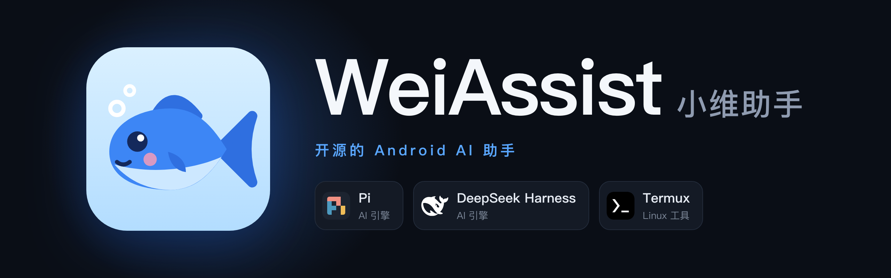
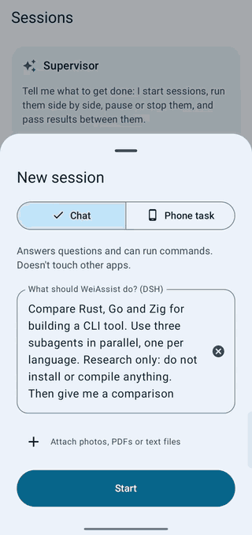
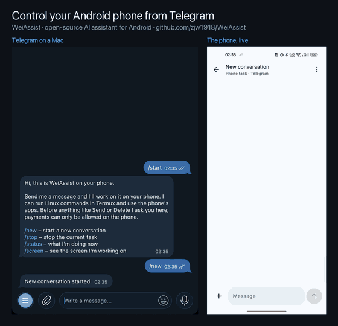
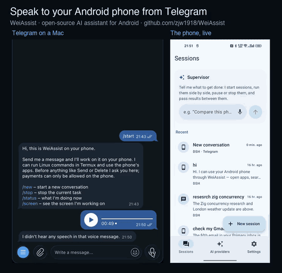
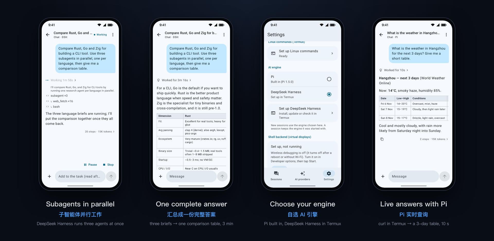

# 小维助手 WeiAssist 🐟 — 装在你 Android 手机上的 AI 助手

<p align="center">
  <picture>
    <source media="(prefers-color-scheme: light)" srcset="docs/images/banner-zh-light.png">
    
  </picture>
</p>

<p align="center">
  <a href="https://github.com/zjw1918/WeiAssist/releases/latest"></a>
  <a href="https://github.com/zjw1918/WeiAssist/actions/workflows/ci.yml"></a>
  
  <a href="LICENSE"></a>
</p>

<p align="center"><a href="README.md">English</a> · <b>简体中文</b></p>

小维助手是一个开源的、运行在手机上的 AI 助手。你可以用自己选的 AI 服务和它聊天，发给它照片和文件，让它运行 Linux 命令、替你操作手机上的应用，还能同时进行多个对话。不在手机旁边？用 Telegram 也能找它。

**AI 引擎由你选。** 智能体循环可以跑在内置的 [Pi](https://github.com/earendil-works/pi) 上，也可以跑在 [DeepSeek Harness](https://github.com/deepseek-ai/deepseek-harness) 上（应用会帮你安装）。中间没有我们的服务器：应用直接连接你的 AI 服务，密钥只保存在手机上。

**新功能：把手机变成 AI 网关。** 装上可选的“网关”应用，手机就会运行 [magpie](https://github.com/yetone/magpie)：用你的订阅和密钥登录一次，所有引擎、手机上的其他应用和局域网里的设备都能通过同一个 API 使用它们。[详见下文](#ai-网关magpie)。

[下载](https://github.com/zjw1918/WeiAssist/releases/latest) · [Termux 设置](docs/TERMUX.md) · [Telegram](docs/TELEGRAM.md) · [AI 网关](#ai-网关magpie) · [语音输入](#语音输入) · [架构](docs/ARCHITECTURE.md) · [进度](docs/PROGRESS.md) · [路线图](docs/ROADMAP.md)（文档为英文）

## 安装

从 [Releases](https://github.com/zjw1918/WeiAssist/releases/latest) 下载 APK 并打开。Android 询问时，允许浏览器或文件管理器安装应用。

可选：**网关**（同一版本中的 `Gateway-<版本>.apk`）让手机成为 AI 网关，服务本机应用和局域网设备（见 [AI 网关](#ai-网关magpie)）。只用助手的话不必安装。

## 快速开始

1. 打开小维助手，连接一个 AI 服务：用 ChatGPT、SuperGrok 或 X Premium 账号登录，或粘贴 API 密钥。如果网关应用已开启并登录，也可以点 **使用网关**。
2. 新建一个对话，问它点什么。
3. 可选，都在 **设置** 里：
   - **Linux 命令：** 按引导设置 [Termux](https://termux.dev)，它就能查资料、处理数据、写代码并运行。
   - **AI 引擎：** 继续用 Pi，或安装 DeepSeek Harness（需要 Termux，约 1.5 GB 空间，安装需 10–30 分钟）。
   - **手机任务：** 打开它的无障碍服务，让它操作手机上的应用。
   - **Telegram：** 配对一个机器人，随时随地找它（[说明](docs/TELEGRAM.md)）。

## AI 引擎

| | **Pi** | **DeepSeek Harness** |
| --- | --- | --- |
| 安装 | 内置 | 在 设置 → AI 引擎 一键安装；在 Termux 里装好 Ubuntu、Node.js 和 dsh |
| 能力 | 精简、快速的智能体循环 | 自带文件、bash、子智能体、网页抓取、技能和工作流 |
| 版本 | 随应用附带 | 默认安装测试过的版本；也可以装更新的或任意版本，随时退回 |

两个引擎使用同样的 AI 服务、密钥和登录，也都有应用的手机工具和安全检查。每个对话一直使用它开始时的引擎。

## AI 网关（magpie）

“网关”是另一个可选应用，把你的手机变成 AI 网关。它运行 [magpie](https://github.com/yetone/magpie)（为 Android 构建，整个网关就在一个应用里）：你的服务商、订阅、路由和格式转换，集中在手机上。

- **一个开关，所有引擎。** 在小维助手的 **AI 服务 → AI 服务商来源** 里选 **WeiAssist**（在应用里设置的服务商）或 **网关**。选网关后，Pi 和 DeepSeek Harness 的每个请求都发给它。随时可以切回，两边各自记住自己的服务商和模型。
- **你的订阅，处处可用。** 在网关的控制台登录一次（ChatGPT 等订阅，或 API 密钥）：助手、手机上的其他应用和局域网里的设备都用同样的账号。
- **每个模型用它自己的格式。** 网关原生支持 Anthropic Messages 或 OpenAI Responses 格式的模型，就用那个格式请求，思考、缓存和推理不经转换、完整保留。
- **给你的设备一个 API。** 兼容 OpenAI、Anthropic 和 Gemini：局域网里是 `http://<手机 IP>:3425/v1`，手机上是 `http://127.0.0.1:3425/v1`。任何工具和电脑都能直接用。

设置步骤：

1. 从[同一版本](https://github.com/zjw1918/WeiAssist/releases/latest)安装 `Gateway-<版本>.apk` 并打开。
2. 打开开关。允许它的通知（靠它保持服务），并在 **应用设置** 里允许自启动，这样手机重启后它会再启动。
3. 点 **打开控制台**，登录你的订阅或添加密钥。局域网里的设备需要网关密钥，也在那里创建。
4. 在小维助手里选 **AI 服务 → 网关**。

不装网关，小维助手照常可用。选用网关时如果它停了，助手会告诉你，不会自己换成其他服务商。

## 语音输入

用说话代替打字，在应用里和 Telegram 语音消息中都可以。语音由你自己的 Apple Silicon Mac 上的一个小服务器用 MLX Whisper 转成文字，不使用手机自带的语音识别。

1. 在 Mac 上安装工具并启动服务器。第一次运行会下载模型（约 1.6 GB）。

   ```sh
   brew install uv ffmpeg
   git clone https://github.com/zjw1918/WeiAssist.git
   cd WeiAssist/tools/voice-server
   ./server.py
   ```

   如果 macOS 询问是否允许传入连接，请选择允许。
2. 在小维助手中打开 **设置 → 语音输入**，填入 Mac 的 IP 地址（可在“系统设置 → 网络”中查看），例如 `192.168.1.20`。点 **保存并测试**，应显示 **已连接**。
3. 选择你说的语言。选错的话，转出来的文字会是乱的。
4. 点输入框里的麦克风，说话，然后点 **完成**。文字会留在输入框里，由你检查后发送。在 Telegram 中直接发语音消息：机器人会显示它听到的内容，并立刻照做。

手机必须能连到 Mac，通常是在同一个 Wi-Fi 下。模型下载完成后，在该文件夹运行 `./install-launchd.sh`，服务器就会在每次登录时自动启动（`--uninstall` 可移除）。

服务器**没有密码**：同一网络中的任何人都能使用，请只在你信任的网络中运行。音频在每次请求后删除，转写内容不写入日志。更多说明：[tools/voice-server](tools/voice-server)（英文）。

## 演示

### 子智能体

<p align="center">
  
</p>

用 DeepSeek Harness 时，一个任务可以同时运行多个子智能体。每个子智能体都有自己的实时卡片，显示它的思考、步骤、用时和报告。全部完成后才给出答案：主智能体的汇总，其余过程点开即可查看。

### 用 Telegram 找它

<p align="center">
  
</p>

用 [BotFather](https://t.me/BotFather) 创建一个机器人，把它的 token 粘贴到 **设置 → Telegram**，再配对你的账号。每个聊天就是一个对话：回答实时显示，能收发照片和文件，有风险的操作前会先问你（✅ / ❌）。不需要服务器。详见 [docs/TELEGRAM.md](docs/TELEGRAM.md)。

<p align="center">
  
</p>

它也能听懂语音消息：在你自己的 Apple Silicon Mac 上运行语音服务器即可，详见[语音输入](#语音输入)。应用里的麦克风用的也是这台服务器。

## 它能做什么



- **多家 AI 服务：** OpenAI、Anthropic、Google、DeepSeek、OpenRouter、xAI、Moonshot、Mistral、OpenCode，以及任何兼容 OpenAI 的服务（Ollama、vLLM、LM Studio 等）。
- **手机上的 AI 网关：** 有了网关应用，你的订阅和密钥通过同一个 API 服务所有引擎、其他应用和局域网（[详见](#ai-网关magpie)）。
- **照片和文件：** 发给它图片、PDF 和文档；它也会把做好的文件发回给你。
- **手机上的 Linux：** 有了 Termux，它能上网查资料、分析数据、构建和运行代码，长任务在 `tmux` 里持续运行。
- **同时进行多个对话，** 每个都在后台运行、保留历史；还有一个总管对话，可以用打字或语音替你开始、查看和停止它们。
- **手机任务：** 它能操作你的应用，遇到发送、支付、删除这类操作会先问你。
- **中英文界面。**

## 隐私与安全

- 小维助手没有服务器。你的消息、附件、命令输出，以及手机任务中相关的屏幕内容，只会发给你选择的 AI 服务。密码输入框的内容永远不会发出。
- 登录信息只保存在手机上，用 Android Keystore 加密。DeepSeek Harness 通过应用访问你的 AI 服务，自己不持有任何密钥。
- 无论用哪个引擎，发送、支付、删除这类操作前都会先问你；随时可以停止。
- 网关应用的登录保存在它自己的应用数据里；小维助手不会把自己的密钥复制过去。手机上的任何应用都能不带密钥使用网关；其他设备需要网关密钥。

更多见 [SECURITY.md](SECURITY.md)。

## 文档

| 目标 | 从这里开始 |
| --- | --- |
| 设置 Linux 命令 | [docs/TERMUX.md](docs/TERMUX.md) |
| 用 Telegram 找它 | [docs/TELEGRAM.md](docs/TELEGRAM.md) |
| 使用 AI 网关 | [AI 网关](#ai-网关magpie) · [docs/ARCHITECTURE.md](docs/ARCHITECTURE.md#where-the-ai-providers-come-from) |
| 了解整体架构 | [docs/ARCHITECTURE.md](docs/ARCHITECTURE.md) |
| 看已完成和接下来的工作 | [docs/PROGRESS.md](docs/PROGRESS.md) · [docs/ROADMAP.md](docs/ROADMAP.md) |
| 参与贡献 | [CONTRIBUTING.md](CONTRIBUTING.md) |

## 开发

需要：Android SDK（platform 37）、[`.nvmrc`](.nvmrc) 指定版本的 Node 和 npm，以及 JDK。

```bash
git submodule update --init      # magpie/upstream：网关应用的源码（构建需要 Go）
./gradlew assembleDebug          # 同时打包 Pi（pi-host/）和 DeepSeek Harness 桥接（dsh-host/）；构建两个应用
./gradlew testDebugUnitTest lint
cd pi-host && npm test           # 内置智能体的端到端测试
cd dsh-host && npm test          # dsh 桥接测试；设置 DSH_RUN 和 DSH_HOME 后针对真实的 dsh 运行
```

推送版本标签（`git tag v0.2 && git push origin v0.2`）后，Release 工作流会构建并签名 APK。本地的
`assembleRelease` 只有找到 `keystore.properties`（在 `WEIASSIST_SIGNING` 指定的位置，或
`~/.android/weiassist-release/`）时才会签名。

## 许可证

[Apache License 2.0](LICENSE)。附带的第三方软件见 [NOTICE](NOTICE)。

感谢 [Pi](https://github.com/earendil-works/pi)（MIT，Mario Zechner）、[magpie](https://github.com/yetone/magpie)（MIT，yetone；用于网关应用）、[DeepSeek Harness](https://github.com/deepseek-ai/deepseek-harness)（MIT，DeepSeek；按需安装到 Termux，不随应用附带）和 [Termux](https://termux.dev)。产品名称和标志归其各自所有者；小维助手与任何 AI 服务商均无关联。
